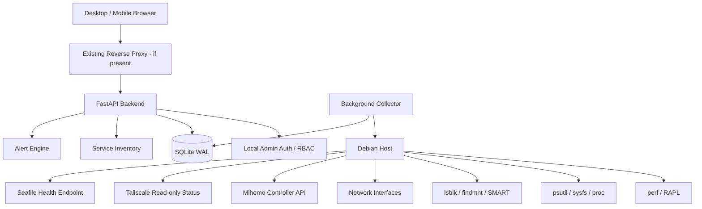

# HomeNAS — Architecture & Data Flow

## 1. Logical architecture

## 2. Process boundaries

### homenas-api

- Runs as an unprivileged dedicated user.
- Serves the built Vue application and API from one origin.
- Reads historical data and configuration.
- Authenticates local administrators.
- Exposes only fixed business operations.
- Does not execute arbitrary shell commands.

### homenas-collector

- Runs as a separate systemd service.
- Collects metrics on configured intervals.
- Does not expose a network listener.
- Uses the minimum permissions required by each collector.
- Writes through a controlled database writer or local IPC.

### Optional privileged helpers

Some hardware operations may require elevated access. Do not solve this by running the whole API as root.

- perf: evaluate CAP_PERFMON or another narrow permission mechanism against the installed kernel and perf version.
- SMART: evaluate device permissions and a fixed, allowlisted helper if necessary.
- Never provide a generic root command runner.
- Never use unrestricted `sudo smartctl *`.

## 3. Data flow

1. Collector reads hardware and service state.
2. Collector normalizes values into metric samples with timestamp, unit, source and quality.
3. Short-term live samples are held in a bounded ring buffer.
4. Aggregates are written in batches to SQLite.
5. API reads persisted aggregates and live samples.
6. Frontend obtains an initial snapshot through REST.
7. Frontend receives updates through WebSocket or SSE.
8. Alert engine evaluates threshold rules with duration, hysteresis and deduplication.
9. Service Inventory combines systemd/Docker discovery with manually registered manifests.

## 4. Power data semantics

| RAPL domain | Meaning | UI treatment |
|---|---|---|
| Package | CPU package energy | Primary CPU power metric |
| Cores | Core domain energy | Separate domain |
| GPU | Integrated GPU domain energy | Separate domain |
| DRAM | Memory domain energy | Separate domain |
| PSys | Platform/system domain where supported | Experimental until validated |

Never sum overlapping domains. Do not label Package or unvalidated PSys as measured wall-socket power.

## 5. Network data semantics

Track counters per interface. Physical and virtual interfaces may observe the same traffic at different layers. Do not sum them blindly. Show per-interface counters and clearly label any derived aggregate.

## 6. Security boundaries

- Browser -> HomeNAS API only.
- Browser never receives Mihomo Secret.
- HomeNAS does not become an identity provider for Seafile.
- Tailscale is monitored, not reconfigured.
- Seafile is health-checked, not internally modified.
- HomeNAS does not manage arbitrary application installation.
